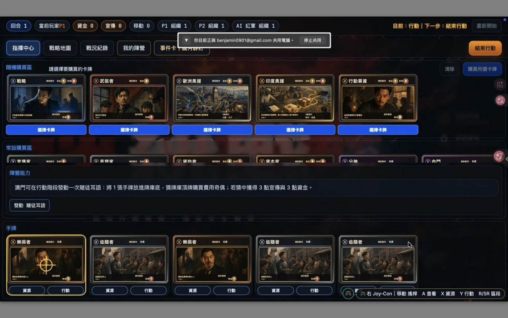

# 指揮中心「陣營能力」位置調整需求

記錄日期：2026-10-20
狀態：待實作

## 使用者需求

將「陣營能力」移到畫面右上角，放在「隨機購買區」最右邊。

## 現況

參考畫面中，「陣營能力」是位於常設購買區下方、手牌區上方的獨立橫向區塊。

## 目標版面

- 「陣營能力」位於指揮中心右上角。
- 「陣營能力」與「隨機購買區」位於同一上方區域。
- 「陣營能力」放在隨機購買卡的最右邊。
- 保留完整能力說明及能力操作按鈕。
- 不遮住五張隨機購買卡、購買操作、右側控制項或回合控制。
- 不改變隨機購買卡數量、購買規則、焦點狀態或 Joy-Con 操作。
- 保持固定 `1280 × 720` 舞台等比例縮放。

## 驗收證據

實作後需用正式 Browser UI 截圖確認：

1. 「陣營能力」位於右上角及隨機購買區最右邊。
2. 能力文字與操作按鈕清楚可讀。
3. 隨機購買卡及其按鈕完整可見。
4. 右側控制項及回合控制沒有被遮擋。
5. 焦點框、準星、白色已選遮罩與 Joy-Con 操作維持既有行為。

## 參考圖

